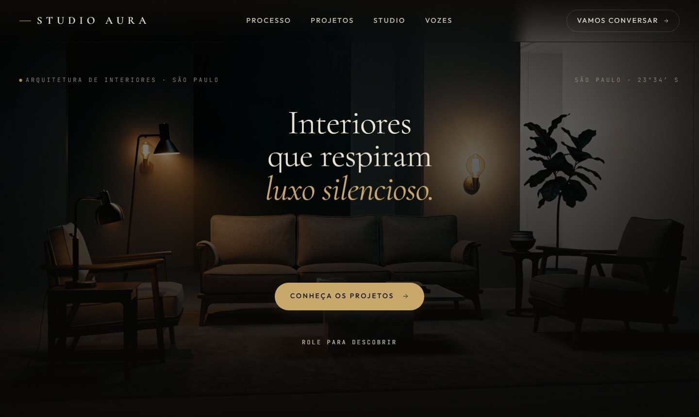

# Studio Aura

Landing page de um estúdio de arquitetura de interiores em São Paulo. A apresentação combina vídeo, fotografia e tipografia editorial para mostrar o portfólio e explicar o processo de trabalho do estúdio.

**[Acessar o site publicado](https://matvolotao.github.io/landing-page-aura-design/)**

[](https://matvolotao.github.io/landing-page-aura-design/)

## Experiência do site

- **Portfólio editorial.** Uma grade assimétrica apresenta seis ambientes. Cada fotografia abre em uma visualização ampliada com uma breve descrição e navegação entre os projetos. [Explorar o portfólio](https://matvolotao.github.io/landing-page-aura-design/#portfolio)
- **Processo de trabalho.** O avanço do vídeo acompanha a rolagem e revela as três etapas do projeto, da leitura do espaço à entrega. [Conhecer o processo](https://matvolotao.github.io/landing-page-aura-design/#processo)
- **Contato.** O formulário de orçamento demonstra a validação dos campos e apresenta o resultado no próprio navegador. [Testar o formulário](https://matvolotao.github.io/landing-page-aura-design/#contato)

## Decisões de implementação

| Decisão | Aplicação |
| --- | --- |
| **Estrutura estática** | HTML semântico, CSS e JavaScript nativo. A página é publicada a partir dos arquivos estáticos e roda localmente sem compilação. |
| **Layout e identidade visual** | CSS Grid organiza a galeria em diferentes larguras. Variáveis CSS centralizam cores, tipografia e espaçamentos. |
| **Galeria acessível pelo teclado** | O elemento nativo `<dialog>` mantém a navegação dentro da visualização ampliada. As setas alternam as fotos, `Esc` fecha a galeria e o foco volta à foto de origem. |
| **Animação com alternativa estática** | GSAP e ScrollTrigger sincronizam a apresentação do processo com a rolagem. Quando a biblioteca está indisponível ou o navegador indica preferência por movimento reduzido, as três etapas aparecem como cartões. |

## Executar localmente

Clone o repositório e abra `index.html` no navegador.

```bash
git clone https://github.com/MatVolotao/landing-page-aura-design.git
cd landing-page-aura-design
```

Para servir o projeto por HTTP, execute `python -m http.server 8000` na raiz com o Python instalado e acesse `http://localhost:8000`. O site carrega as fontes e as bibliotecas de animação via CDN.

## Estrutura do repositório

| Caminho | Conteúdo |
| --- | --- |
| [`index.html`](index.html) | Estrutura e conteúdo da landing page |
| [`css/styles.css`](css/styles.css) | Tokens, componentes e estilos responsivos |
| [`js/main.js`](js/main.js) | Navegação, galeria, formulário e animação do processo |
| [`assets/`](assets/) | Fotografias e vídeos usados na página |

O GitHub Pages publica a partir da raiz da branch `main`.

## Créditos

Adaptação e desenvolvimento front-end por **Matheus Volotão**. [GitHub](https://github.com/MatVolotao) · [LinkedIn](https://www.linkedin.com/in/matheusvolotao/)

Studio Aura é uma marca fictícia criada para este projeto de portfólio. As imagens e os vídeos de interiores vieram do briefing original. O retrato da fundadora foi gerado por IA, e os depoimentos e canais de contato são ilustrativos.
